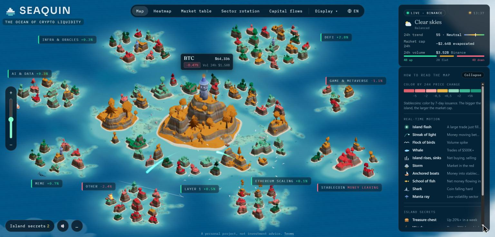
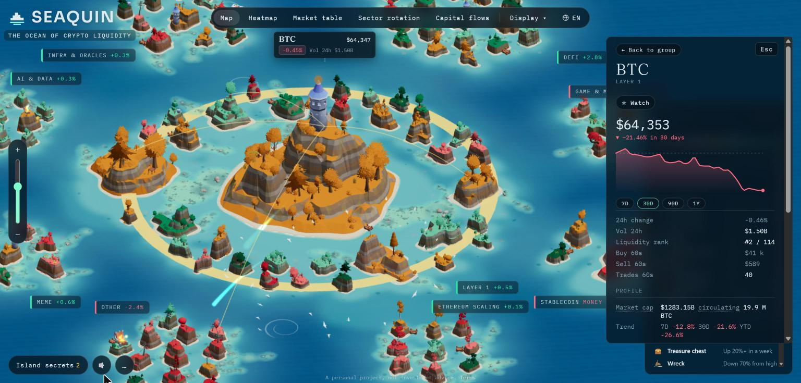
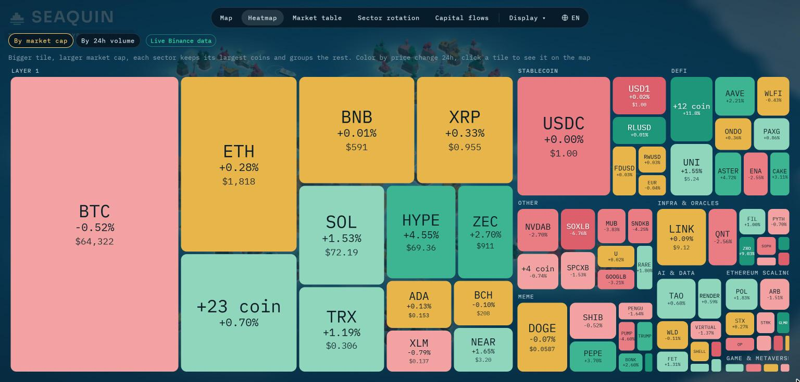
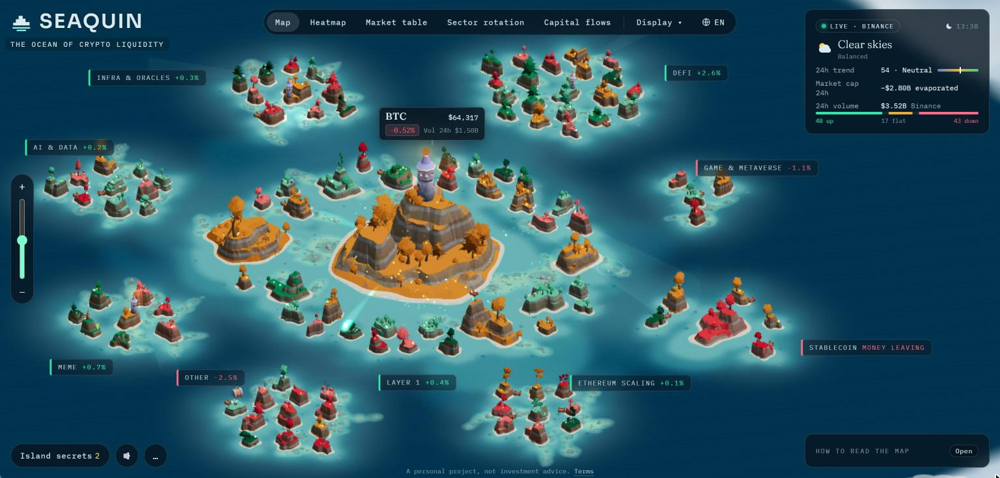

# Seaquin

**The crypto market as a living ocean map.** Live at **[seaquin.app](https://seaquin.app)**

Every coin is an island. Its size follows market cap, its colour follows the 24h price change, and the sea around it moves with real trades streamed from Binance. Ships carry money between islands, whales surface on single trades of $500K or more, and a storm rolls in when most of the market turns red.

## What you can do

- **Read the market at a glance.** About 120 coins grouped into sector archipelagos (Layer 1, DeFi, Meme, AI and Data, Stablecoins and more).
- **Open any island** for its price chart (7 days to 1 year), 24h volume, distance from the 52-week high and a short profile.
- **Switch views:** a heatmap, a sortable market table, sector rotation and capital-flow reports.
- **Change the lens:** colour islands by price change, distance from the 52-week high, volume spikes or buy/sell pressure.
- **Watch the day go by:** the map follows your local time, with a warm glow at sunset, lighthouses and fireflies at night.
- **Use it in four languages:** English, Vietnamese, Spanish and Japanese.

## Screens

| Coin detail | Heatmap |
|---|---|
|  |  |

## How it is built

| Part | Choice |
|---|---|
| 3D scene | three.js, instanced meshes, custom shaders for water, wildlife and lights |
| Data | Binance public market data (WebSocket and REST), DefiLlama, Alternative.me |
| Build | Vite |
| Hosting | Cloudflare Pages, strict Content Security Policy |
| Analytics | Cloudflare Web Analytics, no cookies |
| 3D assets | KayKit, Kenney and Quaternius (CC0) |

The scene steps its own quality down on slower devices, and the page loads in about one second (measured by Cloudflare Web Analytics).

## About

Seaquin is a personal, non-commercial project. It has no ads, no sponsorship and no referral links, and it is not investment advice. The source code is private; this repository only presents the project.

Made by **Phúc Quý**: [LinkedIn](https://www.linkedin.com/in/quy-nguyen-phuc-9ab5732a5/)
